# PHAROS — End-to-End Engineering Review & Verification Report

## 1. Binary & Manifest Inspection (`apkanalyzer`, `llvm-readelf`, `jarsigner`)

| Verification Check | Tool Used | Target Requirement | Measured Result | Status |
| :--- | :--- | :--- | :--- | :--- |
| **Application ID** | `apkanalyzer` | `org.pharos.mesh` | `org.pharos.mesh` | **PASS** |
| **Minimum SDK** | `apkanalyzer manifest min-sdk` | `23` (Android 6.0) | `23` | **PASS** |
| **Target & Compile SDK** | `apkanalyzer manifest target-sdk` | `36` (Android 16) | `36` (`compileSdk 36.1`) | **PASS** |
| **Rule Zero (No Internet)** | `apkanalyzer manifest permissions` & [check_no_internet_perm.ps1](file:///C:/Users/Admin/.gemini/antigravity/scratch/pharos/scripts/check_no_internet_perm.ps1) | `0` occurrences of `android.permission.INTERNET` | `0` occurrences across all merged manifests & packaged APK | **PASS** |
| **Play Store Install Policy** | [check_no_internet_perm.ps1](file:///C:/Users/Admin/.gemini/antigravity/scratch/pharos/scripts/check_no_internet_perm.ps1) | `0` occurrences of `REQUEST_INSTALL_PACKAGES` | `0` occurrences | **PASS** |
| **16 KB Native Page Alignment** | `llvm-readelf -l` via [check_16kb_alignment.ps1](file:///C:/Users/Admin/.gemini/antigravity/scratch/pharos/scripts/check_16kb_alignment.ps1) | All `.so` `LOAD` segments `>= 0x4000` (`16384` B) | **70/70** `.so` binaries (`arm64-v8a`, `armeabi-v7a`, `x86_64`) verified `>= 0x4000` | **PASS** |
| **Cryptographic Signing** | `jarsigner -verify` | V1/V2/V3 signed APK & AAB | `jar verified.` on both `.apk` and `.aab` | **PASS** |
| **R8 Shrinking & Obfuscation** | Gradle `minify*ReleaseWithR8` | Enabled with JNI keep rules | Enabled (`3.26 MB` Universal APK, `4.35 MB` Play Store AAB) | **PASS** |

---

## 2. End-to-End Multi-Node Pipeline Flow

```mermaid
flowchart LR
    subgraph Charlie["Node C (Charlie — Stranded Survivor)"]
        C1["Record 10s Codec2 700C Voice (1,000 B)"] --> C2["Sign TacticalCard + Seal 256B BlindPacket (XChaCha20-Poly1305 + RS(255,240))"]
        C2 --> C3["Transmit 4-PPM Optical Torch (4/8 Hz)"]
    end

    subgraph Mule["Node M (Untrusted Blind Mule)"]
        M1["Decode 4-PPM under 15% Jitter + Heal 5 Corrupted Bytes via RS(255,240)"] --> M2["Store in 50MB / 72h FIFO Ring Buffer (Zero Key Knowledge)"]
        M2 --> M3["Passive GNSS 1575.42 MHz Sync (:00/:15/:30/:45 15s Wake)"]
        M3 --> M4["64B Bloom Filter Reconciliation + Decrement Hop TTL"]
        M4 --> M5["Modulate 48kHz 16-MFSK Walkie-Talkie Audio (800–2300 Hz)"]
    end

    subgraph Alice["Node A (Alice — Rescue Operator)"]
        A1["Demodulate MFSK at 5.0 dB SNR Static + Clipping"] --> A2["Match Blinded Epoch Tag in O(1)"]
        A2 --> A3["Decrypt 200B Payload + Verify 2-Hop WoT Vouch (Bob -> Charlie)"]
        A3 --> A4["Play Codec2 Voice in RAM-Only Handle + Immediate Zeroize on Close"]
    end

    C3 -->|1–5 km Night Line-of-Sight| M1
    M5 -->|2–10 km Analog Radio 5 dB SNR| A1
```

---

## 3. Module-by-Module Test Suite Results (`22/22` Automated Tests Passing)

1. **`:core:protocol` ([ProtocolUnitTest.kt](file:///C:/Users/Admin/.gemini/antigravity/scratch/pharos/core/protocol/src/test/kotlin/org/pharos/core/protocol/ProtocolUnitTest.kt)) — 4/4 PASS**
   - `RS(255, 240)` repairs 1 to 7 arbitrary corrupted bytes across 25 randomized trials.
   - `RS(255, 223)` outer block repairs 16 burst-corrupted bytes.
   - `BlindPacket` 256-byte wire codec masks outer headers, survives 6 simultaneous channel byte corruptions, and preserves AEAD associated data across intermediate Blind Mule TTL hop decrements.
   - `TacticalCard` serializes & deserializes all coordinates, status tiers, 8-byte fingerprints, 64-byte detached signatures, and UTF-8 notes within the exact 200-byte payload budget.

2. **`:core:crypto` ([CryptoUnitTest.kt](file:///C:/Users/Admin/.gemini/antigravity/scratch/pharos/core/crypto/src/test/kotlin/org/pharos/core/crypto/CryptoUnitTest.kt)) — 6/6 PASS**
   - Official IETF CFRG `HChaCha20` (Section 2.2.1), RFC 8439 `Poly1305` (Section 2.5.2), and `XChaCha20-Poly1305` AEAD Known-Answer Tests (KATs) match byte-for-byte.
   - Blinded Epoch Tag trial matching rejects wrong channel keys in `O(1)` and authenticates multi-hop packets.
   - `SPAKE2` Password-Authenticated Key Exchange derives identical 256-bit keys and 4-word SAS phrases from shared human memories while rejecting wrong memories.
   - 2-hop Web-of-Trust (`WebOfTrustGraph`) validates 1-hop and 2-hop vouched peers and cascade-revokes vouchees upon receiving a signed `NODE_COMPROMISED` Duress tombstone.
   - 6×6 Paper One-Time Pad (`PaperOtpCodebook`) generates 36 unique 4-digit PIN cells.

3. **`:core:storage` ([StorageUnitTest.kt](file:///C:/Users/Admin/.gemini/antigravity/scratch/pharos/core/storage/src/test/kotlin/org/pharos/core/storage/StorageUnitTest.kt)) — 3/3 PASS**
   - `BlindMuleRingBuffer` enforces strict byte-capacity FIFO eviction, 72-hour age expiration, deduplication, and `LIFE_SAFETY_WAKE` priority relay ordering.
   - `RamOnlyMediaVault` zeroizes caller plaintext buffers immediately upon encryption, decrypts strictly into an in-RAM `AutoZeroizingMediaHandle`, and overwrites the RAM buffer with `0x00` on `close()`.
   - `PharosEncryptedVault` executes Duress PIN (`9911`) cryptographic erasure in **`<100ms`** (`KeyStore.deleteEntry()`, master key header zeroization, ring buffer wipe) and switches into the First-Aid Decoy state.

4. **`:core:optical` ([OpticalUnitTest.kt](file:///C:/Users/Admin/.gemini/antigravity/scratch/pharos/core/optical/src/test/kotlin/org/pharos/core/optical/OpticalUnitTest.kt)) — 3/3 PASS**
   - 4-PPM long-range Torch modulator/demodulator recovers 256-byte `BlindPacket` frames under **15% amplitude jitter** and 5 full-byte symbol corruptions.
   - 4×4 VSync Matrix renderer and `240×240` perimeter-locked ROI tracker recover 64-frame (256-byte) bursts under pixel noise.
   - `ManualMorseCodec` encodes and decodes human flashlight pulses (`SOS 2026`) with `±25ms` timing jitter.

5. **`:core:mesh` ([MeshUnitTest.kt](file:///C:/Users/Admin/.gemini/antigravity/scratch/pharos/core/mesh/src/test/kotlin/org/pharos/core/mesh/MeshUnitTest.kt)) — 3/3 PASS**
   - `FireflyMeshScheduler` synchronizes to passive GNSS UTC fixes and aligns wake bursts to exact 15-minute (`900,000ms`) boundaries.
   - `BloomSetReconciler` 64-byte (512-bit) Bloom filter accurately identifies missing capsules between peers.
   - `DualSpreaderHotspotServer` serves the single-file Offline HTML5 PWA at `/` in both flavors, blocks `/download/pharos-universal.apk` (`HTTP 403`) in `playStore` flavor, and streams the verified binary `.apk` in `standalone` flavor.

6. **`:core:audio` ([AudioUnitTest.kt](file:///C:/Users/Admin/.gemini/antigravity/scratch/pharos/core/audio/src/test/kotlin/org/pharos/core/audio/AudioUnitTest.kt)) — 4/4 PASS**
   - 48 kHz 16-MFSK (`800–2300 Hz`) WAV loopback recovers 256-byte `BlindPacket` frames under **`5.0 dB SNR`** radio static and limiter clipping.
   - Nokia 3310 Goertzel DTMF decoder extracts `*1*53349*06260#` coordinates under **`5.0 dB SNR`** static.
   - `Codec2VoicePipeline` compresses 10 seconds of 8 kHz speech (`160,000` bytes raw PCM) to `1,000` bytes (`700C`) and `1,500` bytes (`1200bps`) with zero metadata.
   - `SMS-160` (`<= 160` chars) and Bluetooth OBEX `.vcf` formatters validated.

7. **`:app` ([AppIntegrationUnitTest.kt](file:///C:/Users/Admin/.gemini/antigravity/scratch/pharos/app/src/test/kotlin/org/pharos/app/AppIntegrationUnitTest.kt) & [EndToEndSystemTest.kt](file:///C:/Users/Admin/.gemini/antigravity/scratch/pharos/app/src/test/kotlin/org/pharos/app/EndToEndSystemTest.kt)) — 2/2 PASS**
   - Verifies first-launch 8-step interactive walkthrough auto-start, automatic tab switching (`Light` → `Messages` → `Radio & Share`), `660nm` Red Mode toggle, Triple-Press Volume-Down Stealth Blackout, and full 4-node (`Alice`, `Bob`, `Charlie`, `Blind Mule`) multi-transport survival scenario.

---

## 4. Final Signed Release Artifacts

- **Universal Standalone APK (`3.26 MB`):** [PHAROS-universal-release.apk](file:///C:/Users/Admin/.gemini/antigravity/scratch/pharos/PHAROS-universal-release.apk)
  - SHA-256: `d4399b8a96e18c58e0ca06f29bf8779ad2210d1d0f2e18cf31c92fcbf13d1255`
- **Google Play Store App Bundle (`4.35 MB`):** [PHAROS-playStore-release.aab](file:///C:/Users/Admin/.gemini/antigravity/scratch/pharos/PHAROS-playStore-release.aab)
  - SHA-256: `4227309bf3fdc8f5e3fffa3ade0b3cfbde8305af2e486bce31388ff3a780a32d`
