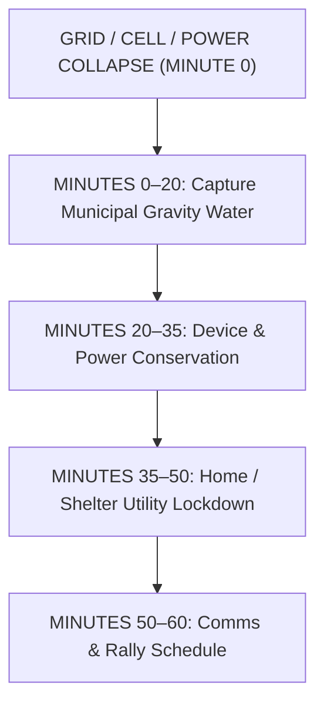
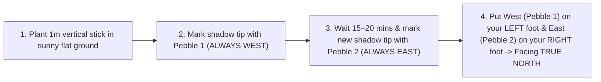

# PHAROS — The Offline All-Hazard Survival Codex
### *Field Reference for Total Grid Collapse, Wilderness Isolation, Trauma, CBRN & Disaster Evasion*

> [!IMPORTANT]
> **The Survival Rule of 3s (Priority Order in Every Crisis):**
> - **3 Seconds** without composure (Panic kills first — Stop, Breathe, Observe, Decide)
> - **3 Minutes** without oxygen or with uncontrolled arterial bleeding
> - **3 Hours** without shelter in extreme cold, driving rain, or desert heat
> - **3 Days** without water
> - **3 Weeks** without food

---

## 1. HOUR ZERO: The First 60 Minutes When Everything Goes Dark

1. **Minutes 0–20 — Capture Gravity-Fed Water Immediately:**
   - When grid power fails, municipal water treatment pumps stop, **but elevated water towers and street mains retain residual gravity pressure for 15 to 45 minutes**.
   - Immediately scrub and fill every bathtub (holds `150–300 Liters`), sink, stockpot, and jug before street pressure drops to zero and back-siphoning contaminates the lines.
   - **Hidden Clean Water Already in Your Home (`120–220 Liters`):**
     - **Hot Water Heater Tank (`110–200 Liters`):** Turn off the circuit breaker/gas valve to the tank, let it cool, open the top hot-water tap in the house (to break the vacuum), and drain clean potable water from the brass drain valve at the bottom of the tank.
     - **Toilet Tank Reservoirs (`6–12 Liters` each):** Scoop from the *upper tank* (NOT the bowl), provided no blue chemical pucks were used.
2. **Minutes 20–35 — Lock Down Phone & Radio Battery (Turn 12 Hours into 4 Days):**
   - A phone hunting for dead cell towers drains its battery `4x` faster by boosting its baseband transmitter to maximum wattage.
   - Switch to **Airplane Mode** immediately, drop screen brightness to `15%`, enable **PHAROS Red Mode (`660nm`)**, and rely on PHAROS's passive `1575.42 MHz` GPS clock sync to wake for **15 seconds every 15 minutes** (`:00`, `:15`, `:30`, `:45`).
3. **Minutes 35–50 — Thermal, Food & Gas Discipline:**
   - **Do NOT open the refrigerator or freezer:** An unopened full freezer keeps food frozen for **48 hours** (24 hours if half-full). Wrap blankets around the outside of the freezer (avoiding compressor vents) to double its insulation.
   - **Gas Lines:** Do *not* shut off your street gas main unless you smell mercaptan (rotten eggs), hear hissing, or see structural damage—once turned off, utility pressure locks require a technician to restore.
   - **Carbon Monoxide (`CO`) Rule:** Never burn charcoal, propane heaters, or camp stoves inside a closed room, basement, or garage. `CO` is odorless, colorless, and binds to hemoglobin `200x` tighter than oxygen.

---

## 2. AUSTERE TRAUMA & FIELD MEDICINE (`MARCH` Protocol)

Always treat casualties in exact **`M-A-R-C-H`** order. Fixing a broken bone while a patient bleeds out or suffocates is fatal.

### M — Massive Hemorrhage (Stop the Bleed in `< 90 Seconds`)
- **Direct Pressure & Wound Packing:** Press hard with two hands directly onto the bleeding source using gauze or a clean cotton shirt. For deep junctional wounds (groin, armpit, neck) where a tourniquet cannot fit, **pack the cavity tightly** finger-by-finger right down to the bleeding vessel, then hold firm continuous pressure for **at least 3 full minutes**.
- **Tourniquet (`CAT` or Improvised Windlass):**
  - Use for bright-red spurting arterial blood or amputations on an arm or leg.
  - Place **`5–8 cm` (2–3 inches) above the wound** toward the heart—**NEVER directly over a joint** (elbow/knee).
  - For an improvised tourniquet: Use a folded triangular bandage or `5 cm` (2-inch) wide strip of strong cloth (never thin wire/shoelaces which cut tissue without stopping deep arteries). Tie a half-knot, place a strong stick (`windlass`) on top, tie a square knot over it, and **twist the stick until bright-red bleeding stops completely** and the distal pulse disappears. Tie the ends of the stick down and write **`TK` + Exact Time** on the casualty's forehead.

### A — Airway
- If unconscious and breathing on their back, the tongue falls backward and blocks the windpipe.
- Roll the casualty onto their side (**Recovery Position**—top leg bent at `90°`, head tilted slightly back and downward) so blood, saliva, or vomit drains out by gravity.

### R — Respiration (Sucking Chest Wounds)
- A puncture wound to the chest wall lets outside air get sucked into the chest cavity with each breath, collapsing the lung (**Tension Pneumothorax**).
- **The 3-Sided Occlusive Dressing:** Wipe blood/sweat around the hole. At the end of an **exhale**, press a square of airtight plastic (Ziploc bag, wrapper, foil) over the hole and **tape down 3 sides tightly, leaving the bottom corner untaped**.
  - When the casualty inhales, the plastic sucks flat against the skin, blocking outside air.
  - When the casualty exhales, trapped air and blood inside the chest push out through the untaped 4th side (flutter valve).

### C — Circulation, Shock & Exact Life-Saving Fluid Formulas

> [!TIP]
> **Exact Medical Solutions You Can Mix Anywhere:**
> 1. **WHO Life-Saving Oral Rehydration Solution (ORS):**
>    - **`1 Liter` (4 cups) clean/boiled water**
>    - **`6 level teaspoons` (`25 g`) sugar**
>    - **`1/2 level teaspoon` (`3 g`) salt**
>    - *Why exact ratios matter:* The small intestine requires glucose (sugar) and sodium in an exact `1:1` molar cotransport ratio (`SGLT1` pump) to pull water across the gut wall into the bloodstream. Too much salt worsens dehydration; too much sugar draws water *out* of the body into the gut.
> 2. **Isotonic `0.9%` Normal Saline for Wound Irrigation:**
>    - **`500 mL` (2 cups) boiled water (cooled to lukewarm) + `1 level teaspoon` (`4.5 g`) non-iodized salt.**
>    - Poke a `1–2 mm` pinhole in the cap of a clean plastic water bottle and squeeze hard to jet-flush dirt and bacteria out of deep cuts before bandaging.

### H — Hypothermia, Burns, Splinting & Bites
- **Severe Burns:** Cool immediately with clean running water for `15 minutes` (never apply ice, butter, or oil). Remove rings, watches, and belts immediately before tissues swell. Wrap loosely in clean **plastic cling-film** (prevents evaporation, blocks bacteria, and doesn't stick to raw tissue). Keep the patient warm and administer **WHO Oral Rehydration Solution** (`~4 mL × kg body weight × % burn area` over 24 hours).
- **Improvised Splinting:** Pad two rigid supports (branches, rolled newspapers, trekking poles) with cloth and tie securely **above the joint above the break AND below the joint below the break**. Always check that fingers/toes remain warm and pink after tying.
- **Snakebite (Venomous):** Do **NOT** cut the wound, do **NOT** suck venom, and do **NOT** apply an arterial tourniquet or ice. Keep the bitten limb immobilized at or slightly below heart level, remove rings/watches, mark the leading edge of swelling with a pen every `15 minutes`, and keep the patient calm and still (walking pumps venom through the lymphatic system).

---

## 3. WATER PROCUREMENT, FILTRATION & DISINFECTION CHEMISTRY

### A. Finding Water When None Is Visible
1. **Dry Riverbeds (Outside Bends):** Water flows fastest and deepest along the **outside curve** of a dry streambed. Dig `30–60 cm` deep in the lowest point of the outside bend shaded by overhang or green willow/cottonwood roots; let muddy water seep in and settle.
2. **Morning Dew Harvesting:** Before sunrise, tie clean absorbent cotton rags or t-shirts around your ankles and walk through knee-high grass, or wipe cold metal car roofs/tarps and wring into a bottle (`up to 0.5–1 Liter/hour`).
3. **Tree Transpiration Bag (Clear Plastic Bag):** Tie a clean, clear plastic bag tightly around a leafy, non-poisonous green tree branch in direct sun with a small pebble weighing down the bottom corner. The leaves transpire pure distilled water (`200–500 mL/day` per bag) with zero boiling required.
4. **Never Drink Un-Distilled:** Seawater (`3.5%` salt requires `1.5 L` of body water to excrete `1 L`), urine, blood, alcohol, or radiator fluid.

### B. The 2-Step Rule: **Filter First (Clarify), Then Disinfect (Kill Pathogens)**
Filtering removes mud, heavy metals, and chemical toxins, **but bacteria and viruses pass right through sand and charcoal**. You must always follow filtration with boiling or chemical/UV disinfection.

1. **Step 1 — Improvised 4-Stage Bio-Charcoal Filter (Inverted 2L Bottle):**
   - Cut the bottom off a 2L bottle, invert it, and layer from the **bottom neck upward**:
     1. `3 cm` tightly packed clean cotton cloth or grass plug
     2. `6 cm` **crushed hardwood charcoal** from a cooled campfire (freshly crushed to pea/powder size—adsorbs chemical pollutants, pesticides, and bad odors)
     3. `6 cm` fine sand
     4. `6 cm` coarse gravel/pebbles
     5. Top cloth pre-filter to catch leaves/sediment
2. **Step 2 — Exact Pathogen Disinfection Table:**

| Method | Exact Dosage per `1 Liter` (`1 Quart`) | Contact / Wait Time | Kills Bacteria & Viruses? | Kills *Giardia* & *Cryptosporidium*? |
| :--- | :--- | :--- | :--- | :--- |
| **Rolling Boil** | Bring to a vigorous rolling boil | **`1 minute`** (`3 min` above `2,000m`) | **YES (100%)** | **YES (100%)** |
| **Household Bleach** (`5%–6%` unscented NaOCl) | **`2 drops`** (clear) / **`4 drops`** (cloudy or `<10°C`) | **`30 minutes`** (`60 min` if `<10°C`) | **YES** | *Giardia* Yes; *Crypto* No |
| **Household Bleach** (`8.25%` concentrated) | **`1–2 drops`** (clear) / **`3 drops`** (cloudy) | **`30–60 minutes`** | **YES** | *Giardia* Yes; *Crypto* No |
| **Calcium Hypochlorite** (`68%` Pool Shock granules, no algaecide) | **Stock:** `5 g` (`1 tsp`) in `7.5 L` (`2 Gal`). **Dose:** `10 mL` (`2 tsp`) stock per `1 L` water. | **`30–60 minutes`** | **YES** | *Giardia* Yes; *Crypto* No |
| **2% Tincture of Iodine** | **`5 drops`** (clear) / **`10 drops`** (cloudy) | **`30 minutes`** (`60 min` if cold) | **YES** | *Giardia* Yes; *Crypto* No |
| **Potassium Permanganate** (`KMnO4` crystals) | Add a few grains until water turns **faint pink** (NOT dark purple!) | **`30 minutes`** | **YES** | Partial |
| **SODIS (Solar UV-A + Heat)** | Clear PET bottle (`<= 2L`), shake to aerate, lay in direct sun | **`6 hours`** full sun (`48 hrs` cloudy) | **YES** | **YES** (if temp `> 50°C`) |

---

## 4. SHELTER, CORE THERMOREGULATION & WET-WEATHER FIRECRAFT

### A. Shelter Physics (Stop Heat Loss by Conduction, Convection & Radiation)
- **The Ground Bed Rule:** Lying directly on cold earth, concrete, or snow drains body heat **`25 times faster`** than cold air. Spend **50% of your shelter-building time on your bed**: pile `15–20 cm` (6–8 inches) of dry leaves, pine needles, dry grass, evergreen boughs, or flattened cardboard boxes *underneath* you.
- **Debris Hut (Wilderness):** Prop a sturdy ridgepole (`2.5m` long) from the ground up to a waist-high stump (`~90 cm` high). Lean strong ribs along both sides at a **`45°` angle** (shallower than `45°` leaks rain inside). Pile `60 cm` (2 feet) of leaves, bark, and moss over the frame. Keep the interior just wide enough for your shoulders so your own `100W` metabolic body heat warms the dead-air space.
- **Urban Freeze Blackout ("Micro-Climate Room"):** Pick one small interior room (or a south-facing room if sunny). Pitch a camping tent—or drape blankets over a dining table—right on top of a mattress. Four people inside a blanket-draped table tent raise the interior temperature by `10°C–15°C` using body heat alone.

### B. Starting a Fire in Pouring Rain
1. **Where Dry Fuel Hides in a Downpour:**
   - Ignore all wood lying on the wet forest floor.
   - Snap **dead branches still attached to standing trees** (off the ground, wind-dried).
   - **Batoning / Splitting:** Take wrist-thick dead branches and split them lengthwise (using a knife and a wooden club/baton, or smashing between two rocks). The inner **heartwood** is bone-dry even after days of rain.
   - **Feather Sticks:** Use your knife blade at a shallow `15°` angle to shave paper-thin curls along the dry inner heartwood without cutting them off—these catch a single spark.
2. **All-Weather Natural Tinders:**
   - **Fatwood (Pine Pitch):** Found at the base node where dead lower branches join the trunk of pine/fir/spruce trees. Smells strongly of turpentine, is waterproof, and lights from a single spark or flame.
   - **Birch Bark:** Contains flammable betulin oil; lights even when soaking wet. Scrape the outer bark into fine powder with the spine of a knife to catch sparks.
3. **5 Improvised Ignition Methods (No Matches / No Lighter):**
   - **Battery + Foil Gum Wrapper / Steel Wool:** Cut a foil-backed paper gum wrapper into an hourglass shape with a narrow `2 mm` bridge in the middle. Press the foil ends to the `+` and `-` terminals of any AA, 9V, power tool, or phone battery—the narrow bridge instantly glows red-hot and bursts into flame.
   - **Car Cigarette Socket / Jumper Spark:** Connect insulated wire to a 12V car battery and touch steel wool or charcloth impregnated with a single drop of vegetable oil/vaseline (never raw gasoline, which explodes in vapor).
   - **Eyeglasses / Magnifying Lens / Water-Filled Clear Bag:** Focus bright midday sun into a pinpoint on dark punk wood or charcoal dust mixed with dry grass.
   - **Flint & High-Carbon Steel / Ferro Rod:** Strike at `30°–45°` into a bird's nest of scraped inner tree bark (cedar, cottonwood, basswood) and dry grass.

---

## 5. CBRN DEFENSE: NUCLEAR FALLOUT, CHEMICAL PLUMES & EMP

> [!CAUTION]
> **Critical Opposite Rule — Nuclear Fallout vs. Chemical Gas:**
> - **Nuclear Fallout** falls *downward* from the sky and accumulates on roofs and the ground -> Go to the **deepest basement or middle-floor core** of a heavy concrete building.
> - **Chemical / Industrial Gas Plumes** (Chlorine, Phosgene, Hydrogen Sulfide, Propane) are **heavier than air** and sink into basements, subways, and low valleys -> Go **UPWIND, UPHILL, and to the TOP FLOORS** of a building!

### A. Nuclear Detonation & The `7-10` Fallout Rule
1. **Immediate Blast Wave (`0–60 Seconds`):**
   - When you see a blinding flash, **do NOT look at it** and **do NOT stand by a window** (the supersonic blast wave arrives `3 seconds per kilometer` after the flash, turning window glass into lethal shrapnel up to `15 km` away).
   - Drop flat on your stomach behind a solid wall or ditch, cover your head, put **thumbs in ears**, and keep your **mouth slightly open** to equalize pressure across your eardrums and lungs.
2. **The 15-Minute Golden Window Before Fallout Arrives:**
   - After the blast wave passes, you have **10 to 20 minutes** before pulverized radioactive sand/ash begins falling from the mushroom cloud stem.
   - Move immediately into the highest-mass shelter available: an underground basement, subway tunnel, or the **center hallway of the middle floors** (e.g., floors 4–7 of a 12-story concrete building, maximizing mass between you and both the roof and the ground).
   - **Gamma Radiation Halving Thicknesses** (thickness of material that cuts radiation by `50%`; 10 halving-thicknesses reduces radiation by `99.9%`):
     - Lead: `1 cm` | Steel: `2.5 cm` | Concrete: `6 cm (2.4 in)` | Packed Earth/Sandbags: `9 cm (3.5 in)` | Water: `18 cm (7 in)` | Books/Wood: `22 cm (8.8 in)`
3. **The `7-10 Rule` of Fallout Decay (Why the First 48 Hours Save Your Life):**
   - Fission products decay rapidly at first:
   $$\text{Dose Rate at } t \text{ hours} = R_1 \times t^{-1.2}$$
   - **1 Hour after detonation:** `100%` radiation intensity (e.g., `1,000 R/hr` outside — fatal in 30 mins)
   - **7 Hours:** Drops to **`10%`** (`100 R/hr`)
   - **49 Hours (~2 Days):** Drops to **`1%`** (`10 R/hr`)
   - **343 Hours (~2 Weeks):** Drops to **`0.1%`** (`1 R/hr`)
   - **Rule:** Stay sealed inside your shelter for **at least 48 to 72 hours** before making any brief outside trip.

---

## 6. ZERO-TECH NAVIGATION (DAY & NIGHT)

1. **The Universal Shadow-Tip Method (Accurate Anywhere on Earth):**
   - Because the Sun always travels from East to West across the sky, **every shadow tip on Earth moves from West to East**.
   - Mark the first shadow tip (**West**), wait `15–20 minutes`, and mark the second shadow tip (**East**). Draw a line between them: standing with the first mark on your left and the second on your right points you **True North** (in both Northern and Southern Hemispheres!).
2. **Analog Watch Method (Or Draw a Watch Face on Paper Based on Current Time):**
   - **Northern Hemisphere:** Hold the watch flat and point the **Hour Hand** directly at the Sun. The line bisecting (halfway between) the Hour Hand and `12 o'clock` points **True South**.
   - **Southern Hemisphere:** Point the **`12 o'clock` mark** at the Sun. The line halfway between `12 o'clock` and the Hour Hand points **True North**.
3. **Natural & Celestial Clues:**
   - **Night Sky (North):** Extend a line through the two outer stars of the Big Dipper's bowl `5x` their distance to locate **Polaris (True North within 1°)**.
   - **Night Sky (South):** Extend the long axis of the **Southern Cross (*Crux*)** `4.5x` its length and drop straight down to the horizon for **True South**.
   - **Crescent Moon Rule:** Draw an imaginary line connecting the two horns (tips) of a crescent moon down to the horizon. In the Northern Hemisphere, that line points roughly **South**; in the Southern Hemisphere, it points **North**.

---

## 7. OFF-GRID POWER SCAVENGING, FARADAY SHIELDING & RESCUE SIGNALS

### A. Emergency 5V USB Phone Charging from Scavenged Batteries
- **Standard USB-A Female Socket Pinout** (looking into the port with the plastic tongue at the bottom, metal contacts facing up):
  - **Pin 1 (Far Right):** `+5V DC` (Red wire)
  - **Pin 2:** `Data -` (White)
  - **Pin 3:** `Data +` (Green)
  - **Pin 4 (Far Left):** `Ground / -` (Black wire)
- **Method 1 — From Any 12V Car, Motorcycle, or Lawn Tractor Battery:**
  - Never connect `12V` directly to USB (`5V`)—it will fry the phone's charging IC instantly.
  - Use any `12V` car cigarette-lighter USB plug: touch a wire from the car battery **`+` terminal to the spring-loaded center tip** of the plug, and a wire from the car battery **`-` terminal to the metal side clips** of the plug.
- **Method 2 — From Four `1.5V` AA, C, or D Alkaline Batteries:**
  - Tape 4 cells end-to-end in series (`+` to `-`) to create `6.0V` open-circuit (which sags safely to `~5.0–5.2V` under a phone's charging load), or 3 fresh cells (`4.5V`) for trickle charging.

### B. Improvised EMP / Solar Superstorm (Carrington Event) Faraday Cage
1. Wrap backup phones, radios, and solar panels in **cardboard or a thick dry towel** (insulation so electronics never touch the outer conductor).
2. Seal inside **3 separate, nested layers of heavy-duty aluminum foil** (folding each seam over 3 times tightly), OR place inside a galvanized steel trash can / metal ammo can with steel wool or foil pressed into the lid gasket seam.

### C. International Ground-to-Air & Acoustic Distress Signals
- **Universal Signal of Three:** `3` fires in a triangle (`30m` apart), `3` whistle blasts (carries `1.5+ km` vs. `200m` for shouting and uses 1/10th the energy), `3` mirror/flashlight flashes.
- **ICAO Ground-to-Air Visual Symbols** (build `6 meters / 20 feet` tall in open clearings using rocks, logs, or trenches stomped in snow):
  - **`V`** — Require Assistance
  - **`X`** — Require Medical Evacuation
  - **`N`** — No / Negative
  - **`Y`** — Yes / Affirmative
  - **`↑`** — Proceeding in this direction

---

## 8. NATURAL DISASTERS, WILDFIRE PHYSICS & URBAN EVASION

| Crisis | Fatal Mistake to Avoid | Exact Survival Action |
| :--- | :--- | :--- |
| **Wildfire** | Running **uphill** or downwind ahead of the fire (chimney effect preheats upslope brush; fire climbs `4x` faster uphill than on flat ground). | Move **downhill and perpendicular (crosswind)** into already-burned black ash (*"the black"*), boulders, or shallow wide rivers. Breathe low to the ground through a wet 100% cotton cloth. |
| **Submerged Car** | Waiting for the car to fill with water or trying to kick out the laminated front windshield. | **First 45 Seconds Rule:** (1) Seatbelts OFF, (2) Roll down or smash **SIDE tempered window** at the bottom corner, (3) Children out first, (4) Out immediately before water reaches window height. |
| **Flash Flood** | Driving through water covering a road (`45 cm` floats a 2-ton SUV) or walking in `15 cm` of fast current. | Abandon stalled vehicles immediately and climb straight up to high ground. If swept into whitewater, float **on your back with feet pointed downstream** at `45°` to fend off rocks (never stand up in fast current—foot entrapment drowns). |
| **Rip Current** | Swimming straight back toward the beach against the current until exhausted. | Swim **parallel to the shoreline** for `30–50 meters` until you exit the narrow outward channel, then swim diagonally back to shore with the breaking waves. |
| **Lightning Outdoors** | Sheltering under an isolated tall tree, on a ridgeline, or lying flat on wet ground (ground current step-voltage passes through heart). | Move to a low depression or dense grove of uniform short trees. **Lightning Crouch:** Balance on the balls of your feet with **heels pressed together** (so ground current enters one foot and exits the other without crossing your torso), head down, hands over ears. |
| **Urban Collapse / Unrest** | Wearing military camo, carrying visible tactical bags, or traveling along main highways/bridges at midday. | **Gray Man Protocol:** Wear dull, unremarkable work clothes; carry gear in a plain grocery/laundry sack; move `45 minutes` before dawn or during heavy rain using secondary backstreets and rail/utility corridors. |

---

## 9. FORAGING: THE UNIVERSAL EDIBILITY TEST & SAFE CALORIES

- **Rule 1:** You can survive **21+ days without food** as long as you have water and warmth. Never eat wild mushrooms, umbrella-shaped white flowering plants (*Hemlock* lookalikes), milky/colored plant sap, three-leaved plants, or white/yellow berries.
- **Safe Universal Wild Foods (Temperate & Sub-Tropical):**
  - **Cattails (*Typha* — "The Supermarket of the Swamp"):** Underground rhizome roots (peel and boil/roast like potatoes—rich in starch), young green shoots, and yellow pollen heads.
  - **Pine Needles & Inner Bark (*Cambium*):** Steep fresh green pine needles in hot (not boiling) water for `10 minutes` -> `5x` the Vitamin C of lemons (prevents scurvy; *avoid Yew, Norfolk Pine, and Ponderosa Pine*). The spongy white inner cambium bark of Pine and Birch can be boiled or roasted in strips.
  - **Acorns (Oak):** Leach bitter tannic acid by crushing shelled acorns and soaking in running stream water (or changing boiling water 3–4 times until water runs clear).
  - **Insects & Freshwater Crustaceans:** Grasshoppers, crickets, cicadas, and grubs are `60%–70%` protein—**always remove legs/wings and boil or roast thoroughly** to kill internal parasites.
