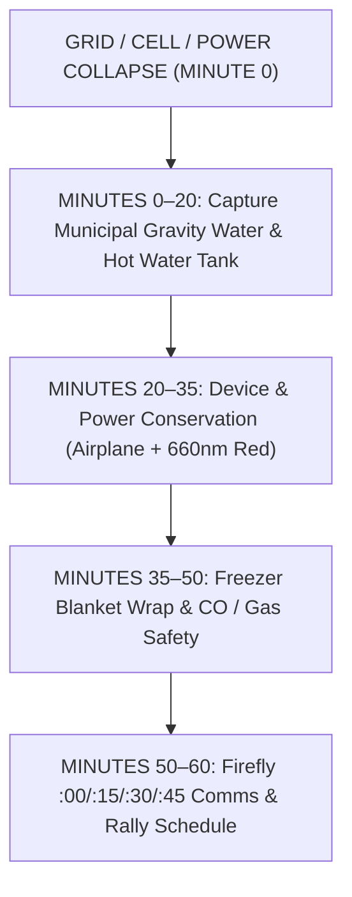

# PHAROS — The Complete Offline All-Hazard Survival Codex (17 Domains)
### *Field Reference for Total Grid Collapse, Wilderness Isolation, Austere Medicine, CBRN, Radio Physics & Disaster Evasion*

> [!IMPORTANT]
> **The Survival Rule of 3s (Priority Order in Every Crisis):**
> - **3 Seconds** without composure (Panic kills first — Stop, Breathe, Observe, Decide)
> - **3 Minutes** without oxygen or with uncontrolled arterial bleeding
> - **3 Hours** without shelter in extreme cold, driving rain, or desert heat
> - **3 Days** without water
> - **3 Weeks** without food

---

## 1. HOUR ZERO: The First 60 Minutes When Everything Goes Dark

1. **Minutes 0–20 — Capture Gravity-Fed Water Immediately:**
   - When grid power fails, municipal water treatment pumps stop, **but elevated water towers and street mains retain residual gravity pressure for 15 to 45 minutes**.
   - Scrub and fill every bathtub (`150–300 Liters`), sink, stockpot, and jug before street pressure drops to zero and back-siphoning contaminates the lines.
   - **Hidden Clean Water Already in Your Home (`120–220 Liters`):**
     - **Hot Water Heater Tank (`110–200 Liters`):** Turn off the circuit breaker/gas valve to the tank, let it cool, open the highest hot-water tap upstairs (to break the vacuum), and drain clean potable water from the brass drain valve at the bottom.
     - **Toilet Tank Reservoirs (`6–12 Liters` each):** Scoop from the *upper tank* (NEVER the bowl), provided no blue chemical pucks were used.
2. **Minutes 20–35 — Lock Down Phone & Radio Battery (Turn 12 Hours into 4 Days):**
   - A phone hunting for dead cell towers drains its battery `4x` faster by boosting its baseband transmitter to maximum wattage.
   - Switch to **Airplane Mode** immediately, drop screen brightness to `15%`, enable **PHAROS Red Mode (`660nm`)**, and rely on PHAROS's passive `1575.42 MHz` GPS clock sync to wake for **15 seconds every 15 minutes** (`:00`, `:15`, `:30`, `:45`).
3. **Minutes 35–50 — Thermal, Food & Gas Discipline:**
   - **Keep Freezer & Fridge Doors Sealed:** An unopened full freezer keeps food frozen for **48 hours**; wrap blankets around the outside (avoiding rear vents) to double insulation.
   - **Gas Lines:** Do *not* shut off your street gas main unless you smell mercaptan (rotten eggs), hear hissing, or see structural damage.
   - **Carbon Monoxide (`CO`) Rule:** Never burn charcoal, propane heaters, generators, or camp stoves inside a closed room, basement, or garage.

---

## 2. AUSTERE TRAUMA (`MARCH` Protocol) & FIELD PHARMACY

### A. `MARCH` Trauma Sequence
1. **M — Massive Hemorrhage (`< 90 Seconds`):**
   - **Direct Pressure & Junctional Wound Packing:** Press hard with both hands directly onto the bleeding vessel. For deep groin, armpit, or neck wounds where a tourniquet cannot fit, pack gauze/clean cotton cloth tightly finger-by-finger down to the bleeding artery and hold firm continuous pressure for **3 full minutes**.
   - **Windlass Tourniquet (Limbs):** Place a `5 cm` (2-inch) wide band `5–8 cm` (2–3 inches) **above** the wound (never over a joint). Tie a half-knot, place a strong stick (`windlass`) on top, tie a square knot over it, twist until bright-red bleeding stops completely, lock the stick, and write **`TK` + Exact Time** on the forehead. *(Never use thin wire, cord, or shoelaces!)*
2. **A — Airway:** Roll unconscious breathing patients onto their side (**Recovery Position**—top leg bent `90°`, head tilted slightly back/down) so blood or vomit drains out by gravity.
3. **R — Respiration (Sucking Chest Wound):** At the end of an **exhale**, cover a bubbling/whistling chest puncture with airtight plastic taped on **3 sides only** (leaving the bottom corner untaped as a one-way flutter valve).

### B. Exact Austere Field Pharmacy Recipes

| Medical Solution | Exact Field Recipe | Clinical Purpose |
| :--- | :--- | :--- |
| **WHO Oral Rehydration Solution (ORS)** | **`1 Liter`** clean water + **`6 level tsp` (`25 g`) sugar** + **`1/2 level tsp` (`3 g`) salt** | Activates intestinal `SGLT1` sodium-glucose cotransport to reverse fatal dehydration, diarrheal, or burn shock. |
| **Isotonic `0.9%` Sterile Saline** | **`500 mL`** boiled water (cooled) + **`1 level tsp` (`4.5 g`) non-iodized salt** | Jet-irrigate deep wounds (through a `1.5 mm` pinhole in a plastic bottle cap) to prevent sepsis. |
| **Quarter-Strength Dakin's Antiseptic** | **`1 Liter`** boiled water + **`25 mL` (`5 tsp`) unscented `5%` bleach** + **`1/2 tsp` baking soda** | Hospital-grade topical bactericidal irrigation for infected/necrotic wounds (`MRSA`, *Pseudomonas*, anaerobes) when antibiotics are unavailable. |
| **Hypertonic Dental Rinse** | **`250 mL`** warm boiled water + **`1 tsp` salt** (+ clove oil / crushed garlic paste on cotton) | Draws pus out of gum abscesses and numbs exposed dental nerves. |

### C. Hypothermia, Frostbite, Burns, Fractures & Envenomation
- **Severe Hypothermia:** Strip wet clothes; insulate underneath from the ground first; place warm water bottles in **armpits and groin** (never rub freezing limbs—triggers fatal "afterdrop" cardiac arrest).
- **Frostbite:** Rewarm in `37°C–39°C` (`98°F–102°F`) water (warm to a healthy elbow) for `30 minutes` **only if there is zero risk of refreezing**.
- **Severe Burns (Parkland Fluid Formula):** Cool with clean water for `15 mins` (no ice/butter), remove rings/watches immediately, wrap loosely in clean plastic cling-film, and give **WHO ORS** over 24 hours:
  $$\text{Total 24h Fluid (mL)} = 4 \text{ mL} \times \text{Body Weight (kg)} \times \%\text{ Body Surface Burned}$$
  *(Give half in the first 8 hours; the patient's palm = `1%` body surface area.)*
- **Snakebite:** Do **NOT** cut, suck, ice, or tourniquet. Immobilize the limb at heart level, remove rings/watches, mark swelling edge every `15 mins`, and carry the patient.

---

## 3. WATER PROCUREMENT, FILTRATION, CHEMISTRY & DISTILLATION

### A. Finding Hidden Water & Distilling Seawater
1. **Dry Riverbed Seepage Well:** Dig `30–60 cm` deep in the lowest point of the **outside bend** of a dry streambed or at the base of green willow/cottonwood trees.
2. **Tree Transpiration Bag:** Tie a clear plastic bag tightly around a leafy, non-poisonous green tree branch in direct sun with a small stone weighing down the bottom corner (`200–500 mL/day` pure distilled water per bag).
3. **Morning Dew Rag:** Before sunrise, tie clean cotton cloths around your ankles and walk through tall grass, then wring into a bottle (`up to 1 Liter/hour`).
4. **Two-Pot Seawater / Toxic Water Distillation:** Fill a pot halfway with seawater, place a heavy cup upright in the center (mouth above water), invert the pot lid on top (handle pointing down over the cup), boil gently, and place cold water/snow on top of the lid so pure steam condenses and drips into the center cup.

### B. Filter First (4-Stage Bio-Charcoal), Then Disinfect
- **4-Stage Inverted Bottle Filter (Bottom Neck to Top):** (1) `3 cm` tight cotton cloth plug -> (2) `6 cm` **crushed hardwood charcoal** from a cooled fire (adsorbs chemical toxins/pesticides) -> (3) `6 cm` fine sand -> (4) `6 cm` coarse gravel + top cloth pre-filter.
- **Exact Pathogen Disinfection Dosages (Wait `30 mins`, or `60 mins` if water `< 10°C`):**
  - **Rolling Boil:** `1 minute` (`3 minutes` above `2,000m / 6,500ft` altitude) — kills **100%** of bacteria, viruses, and protozoa.
  - **Household Bleach (`5%–6%` unscented NaOCl):** **`2 drops/Liter`** (clear) or **`4 drops/Liter`** (cloudy/cold). Per Gallon: `8 drops` (clear) or `16 drops` (cloudy).
  - **Concentrated Bleach (`8.25%`):** **`1–2 drops/Liter`** (clear) or **`3 drops/Liter`** (cloudy).
  - **Calcium Hypochlorite (`68%` Pool Shock granules, no algaecide):** Dissolve `5 g` (`1 tsp`) in `7.5 L` (`2 Gal`) water to make **Stock Solution** -> Add `10 mL` (`2 tsp`) Stock per `1 Liter` water.
  - **2% Iodine Tincture:** **`5 drops/Liter`** (clear) or **`10 drops/Liter`** (cloudy).
  - **SODIS (Solar UV):** Clear PET plastic bottle (`<= 2L`), shake to aerate, lay in direct sun for **`6 hours`** (`48 hours` if cloudy).

---

## 4. SHELTER THERMODYNAMICS & WET-WEATHER FIRECRAFT

### A. Shelter Physics
- **The `15 cm` Ground Bed Rule:** Cold/wet earth conducts heat away `25x` faster than air. Always build a **`15–20 cm` (6–8 inch) compressed bed** of dry leaves, pine needles, evergreen boughs, or cardboard *underneath* your body before building a roof.
- **Waterproof Debris A-Frame:** Prop a `2.5m` ridgepole on a waist-high stump (`90 cm`), lean side ribs at a steep **`45°` angle**, and pile `60 cm` (2 ft) of leaves/bark over the frame.
- **Snow Trench / Quinzhee:** Always dig the sleeping shelf `30 cm` **higher** than the floor trench so heavy cold air sinks into the lower "cold well" away from your body, and poke a `5 cm` roof vent hole.
- **Urban Freeze Blackout ("Room-in-a-Room"):** Pitch a small tent or drape blankets over a dining table on top of a mattress in an interior south-facing room (`+12°C` gain from body heat alone).

### B. Wet-Weather Fire & The Dakota Smokeless Pit
1. **Bone-Dry Heartwood in a Downpour:** Snap dead branches still attached to standing trees (never off the wet ground) and split wrist-thick wood lengthwise (**batoning**) to expose dry inner heartwood; shave paper-thin **feather sticks**.
2. **Waterproof Natural Tinders:** Pine pitch (**fatwood** at the base of dead pine branches) and papery **birch bark** (contains flammable betulin oil that lights even when wet).
3. **Battery + Foil Gum Wrapper Ignition:** Cut a foil-backed paper gum wrapper so the middle bridge is `2 mm` narrow; touch the foil ends to the `+` and `-` terminals of any AA, 9V, or phone battery for instant flame.
4. **Dakota Smokeless Fire Pit (Stealth & High Efficiency):** Dig two `30 cm` deep holes `30 cm` apart and connect their bottoms with a `15 cm` tunnel. Build the fire in the downwind hole; the upwind hole acts as a pressurized air-jet draft, burning intensely with **almost zero visible smoke or flame signature**.

---

## 5. WILD FORAGING, PASSIVE TRAPS & 5 ESSENTIAL KNOTS

### A. Safe Foraging & Passive Traps
- **Deadly Lookalikes to NEVER Touch:** All wild mushrooms, umbrella-shaped white flower clusters (**Poison Water Hemlock**—fatal in minutes), milky/colored sap, 3-leaved vines, white/yellow berries, and bitter shiny seeds.
- **4 Universally Safe High-Calorie Staples:**
  1. **Cattails (*Typha*):** Peel and boil/roast underground rhizome roots (starch), young green shoots, and yellow pollen.
  2. **Pine Inner Bark & Needles:** Boil/roast spongy white inner *cambium* bark strips; steep green pine needles in hot water for `5x` the Vitamin C of lemons (*avoid Yew and Ponderosa*).
  3. **Acorns (Oak):** Crush shelled acorns and soak in running stream water (or change boiling water 4 times) to leach bitter tannins.
  4. **Insects & Grubs:** Grasshoppers, crickets, and beetle grubs (`65%` protein—remove legs/wings and boil/roast thoroughly).
- **Small-Game Snare & Bottle Fish Trap:** Suspend a `10 cm` (4-inch) wire/paracord loop `5 cm` (3 fingers) off the ground inside a narrow brush trail funnel. For fish, cut the top third off a 2L plastic bottle, invert the cone neck-inward into the body, tie securely, bait, and weight with stones in a quiet stream eddy.

### B. Five Essential Survival Knots (Step-by-Step)
1. **Bowline (Non-Slip Rescue Loop That Never Jams):** Make a small overhand loop in the standing line (*"rabbit hole"*). Pass the working end up through the hole, around behind the standing line (*"around the tree"*), and back down into the hole.
2. **Taut-Line Hitch (Adjustable Shelter Guyline):** Wrap around a stake; pass the working end **inside** the loop twice around the standing line, then once **outside** (above) those two wraps, and tuck through. Slides to tension; locks under load.
3. **Clove Hitch (Fast Ridgepole Anchor):** Pass around the pole, cross diagonally over the first wrap to make a second wrap in the same direction, and tuck the working end under the second wrap.
4. **Square / Reef Knot (Joining Equal Ropes):** Right over left and tuck under; then left over right and tuck under.
5. **Prusik Hitch (Climbing / Hauling Friction Grip):** Wrap a tied cord loop 3 times around a thicker rope, passing the loop through itself on each turn. Slides by hand; locks solid when weighted.

---

## 6. CBRN DEFENSE: NUCLEAR FALLOUT (`7-10 Rule`), KI DOSING & GAS PLUMES

> [!CAUTION]
> **Critical Opposite Rule — Nuclear Fallout vs. Chemical Gas:**
> - **Nuclear Fallout** falls *downward* from the sky -> Shelter in the **deepest underground basement or middle-floor core** of a concrete building.
> - **Chemical / Industrial Gas Plumes** (Chlorine, Phosgene, Ammonia, Hydrogen Sulfide, Propane) are **heavier than air** and sink into basements and valleys -> Move **UPWIND, UPHILL, and to the TOP FLOORS**!

1. **Nuclear Flash & Blast (`0–60s`):** Never look at the flash or stand near windows. Drop face-down behind hard cover, **thumbs in ears, mouth slightly open**.
2. **15-Minute Fallout Window & Halving Thickness:** You have `10–20 minutes` before radioactive sand/ash falls. Gamma radiation is cut by `50%` for every **`1 cm` Lead**, **`2.5 cm` Steel**, **`6 cm` Concrete**, **`9 cm` Packed Earth**, or **`18 cm` Water**.
3. **The `7-10` Decay Rule (Stay Sealed Indoors 48–72 Hours):**
   - `1 hour` = `100%` radiation rate
   - `7 hours` = **`10%`** rate
   - `49 hours (~2 days)` = **`1%`** rate
   - `343 hours (~2 weeks)` = **`0.1%`** rate
4. **Decontamination & Potassium Iodide (`KI`) Thyroid Blocking Dosages:**
   - Remove outer clothing outside (`removes 90%` of fallout); shower with soap and lukewarm water (**never use hair conditioner**—it binds radioactive isotopes to hair).
   - **Daily `KI` Dose (when nuclear fallout is confirmed):** Adults `>18y`: **`130 mg`** | Ages `3–18y`: **`65 mg`** | Ages `1m–3y`: **`32 mg`** | Infants `<1m`: **`16 mg`**.
5. **Chemical Respirator Pad & Biological Disinfection:**
   - For acidic gases (**Chlorine, Phosgene, Tear Gas, Smoke**), soak an 8-layer cotton cloth in **baking soda water** (`1 tbsp per 250 mL`), wring damp, and breathe through it.
   - **Biological Surface Disinfection (`0.5%` NaOCl):** `1 part` `5%` bleach + `9 parts` water (`100 mL` per `1 L`). **Handwash (`0.05%`):** `1 part` `5%` bleach + `99 parts` water (`10 mL / 2 tsp` per `1 L`).

---

## 7. ZERO-TECH NAVIGATION, POWER SCAVENGING & RADIO ANTENNA PHYSICS

### A. Zero-Tech Land & Celestial Navigation
- **Universal Shadow-Tip Stick:** Plant a `1m` vertical stick in sunny flat ground. Mark shadow tip 1 (**ALWAYS WEST**). Wait `15–20 mins` and mark shadow tip 2 (**ALWAYS EAST**). Put West on your left foot and East on your right foot -> **Facing True North**.
- **Analog Watch Compass:**
  - *Northern Hemisphere:* Point **Hour Hand** at the Sun; halfway to `12 o'clock` is **True South**.
  - *Southern Hemisphere:* Point **`12 o'clock`** at the Sun; halfway to Hour Hand is **True North**.
- **Night Stars & Sunset Countdown:**
  - *North:* Two outer bowl stars of Big Dipper point `5x` their separation to **Polaris (True North)**. Polaris angle above horizon in degrees (`1 clenched fist at arm's length = 10°`) = your **Latitude**.
  - *South:* Long bar of **Southern Cross (*Crux*)** extended `4.5x` points to **True South**.
  - *Sunset Countdown:* Hold hand horizontally at arm's length under the Sun; each finger width above the horizon = **`15 minutes` of daylight remaining**.

### B. Power Scavenging, Faraday Shielding & Radio Range Multiplier
- **USB-A Female Socket Pinout** (looking into socket, plastic tongue down): **Far Right Pin 1 = `+5V` (Red)**, **Far Left Pin 4 = `GND` (Black)**.
- **12V Car Battery -> 5V Phone:** Wire Car `+12V` to the center tip of a cigarette-lighter USB adapter and Car `-GND` to the side metal springs (or wire `4 × 1.5V` AA/D alkaline cells in series for `6.0V`, which sags to `~5.1V` under load).
- **3-Layer EMP Faraday Shield:** Insulate devices in cardboard/dry cloth, then wrap tightly inside **3 separate, nested layers of heavy-duty aluminum foil**.
- **"Tiger-Tail" Counterpoise Wire (Doubles Handheld Walkie-Talkie Range):**
  $$\text{Quarter-Wave Wire Length (meters)} = \frac{71.25}{\text{Frequency (MHz)}}$$
  - **FRS / PMR446 (`446–462 MHz`):** Attach a **`16 cm` (`6.3 in`)** wire to the antenna ground collar, hanging straight down.
  - **VHF Marine / 2m Ham (`144–156 MHz`):** Attach a **`48 cm` (`19 in`)** wire.
  - **CB Radio (`27 MHz`):** Attach a **`2.64 m` (`8 ft 8 in`)** wire.

---

## 8. DISASTERS, BIOMES & URBAN EVASION

- **Wildfire:** Never run uphill (fire races uphill `4x` faster due to upslope preheating). Escape **downhill and crosswind** into already-burned black ash (*"the black"*), boulders, or shallow rivers; breathe low through a wet cotton cloth.
- **Sinking Vehicle (First 45 Seconds):** Seatbelts OFF -> Roll down or break **SIDE tempered glass** at the bottom corner (never the laminated windshield) -> Children out first -> Exit immediately.
- **Whitewater & Rip Currents:** In fast floodwater, float **on your back with feet downstream at `45°`** (never stand up). In an ocean rip current, swim **parallel to the beach** for `40m` before angling back to shore.
- **Avalanche Burial:** Swim uphill; before snow freezes solid (within `3 seconds` of stopping), cup a hand over your mouth/nose for an air pocket. Spit to see which way gravity pulls saliva, then dig the opposite direction.
- **Lightning (`30-30 Rule`):** If thunder follows flash in `<= 30s` (`10 km`), crouch in a low depression on the **balls of your feet with heels touching** (routes ground step-voltage from one foot to the other instead of through your heart).
- **Desert vs. Arctic vs. Urban:**
  - *Desert:* Rest in shade by day (dig `30 cm` down into cooler sand), travel only at night, keep loose clothes ON to stop sweat evaporation, and never eat dry food without water.
  - *Arctic ("Be Bold, Start Cold"):* Strip layers *before* hiking uphill so you never sweat; put dry warm layers back on the instant you stop.
  - *Urban Collapse (Gray Man & Silcock Key):* Wear drab civilian clothes, carry gear in a plain grocery bag, move `45 mins` before dawn or in heavy rain, and use a 4-way **Silcock key** (or vice-grips on recessed square brass stems) to tap exterior commercial building water spigots.
